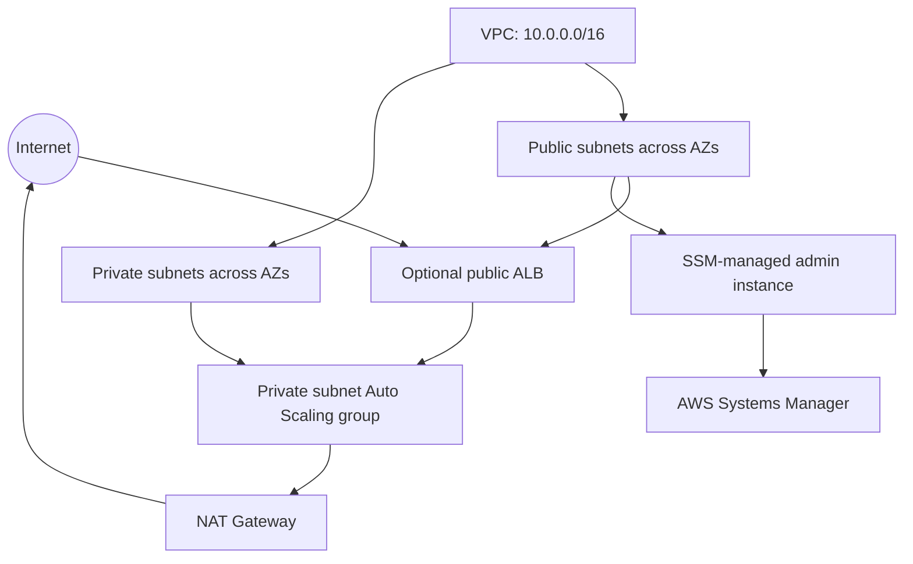

# CloudGate architecture

## Intent

CloudGate is a secure AWS network foundation delivered as Terraform. It demonstrates segmentation, identity-based administration, least-privilege traffic paths, and automated IaC security checks.

## Trust boundaries

- The internet can reach only the optional load balancer.
- Application instances have no public IP addresses.
- Administrative access is through IAM-authenticated Session Manager.
- Security groups reference trusted security groups rather than broad internal CIDRs.
- Optional security services provide network visibility and account-level detection.

The sample application is intentionally small. It demonstrates a secure request path; it is not intended to represent a complete production workload.
